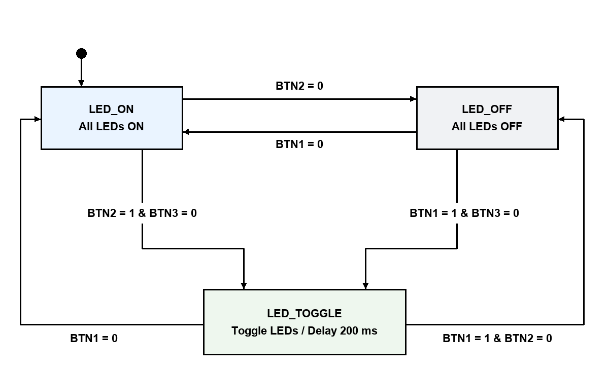

# STM32 버튼 입력과 LED 상태 제어

STM32F411에서 **버튼 3개로 LED 4개의 점등·소등·점멸을 전환**하는 임베디드 C 프로젝트입니다. CH1의 LED 제어를 세 상태를 갖는 유한 상태 머신(FSM)으로 구성해, 현재 모드에서 수행할 출력 동작과 다음 모드로 넘어가는 조건을 코드에서 확인할 수 있습니다.

## 버튼과 LED

| 입력 | GPIO | 선택하는 모드 |
| --- | --- | --- |
| 버튼 1 | `PC0` | 전체 점등 |
| 버튼 2 | `PC1` | 전체 소등 |
| 버튼 3 | `PC3` | 전체 점멸 |

LED 출력은 `PB15`, `PB14`, `PB13`, `PC4`를 사용합니다. 버튼은 Low일 때 눌린 것으로 판단하며, 내부 풀업을 사용하지 않으므로 외부 회로에서 버튼을 놓으면 High, 누르면 Low가 되도록 구성합니다. LED는 출력이 High일 때 켜지는 배선을 기준으로 합니다.

## 상태 머신 구현

`led_state_t` 열거형으로 모드를 정의하고, 메인 루프의 `switch`에서 현재 상태의 처리 함수를 호출합니다. 각 함수는 LED 출력을 처리한 다음 버튼을 읽습니다. 전이 조건이 없으면 현재 모드를 유지합니다.

| 현재 상태 | 출력 동작 | 버튼에 따른 다음 상태 |
| --- | --- | --- |
| `LED_ON` (초기 상태) | 네 출력을 High로 설정 | 버튼 2 → 소등, 버튼 3 → 점멸 |
| `LED_OFF` | 네 출력을 Low로 설정 | 버튼 1 → 점등, 버튼 3 → 점멸 |
| `LED_TOGGLE` | 네 출력을 반전하고 `HAL_Delay(200)`으로 대기 | 버튼 1 → 점등, 버튼 2 → 소등 |

표에서 먼저 적힌 버튼이 같은 상태에서 우선합니다. 점멸 중에는 약 200 ms 간격으로 출력을 반전하며, 버튼 입력은 대기가 끝난 뒤 읽습니다.

### FSM 다이어그램

## 개발 환경과 주요 파일

| 항목 | 내용 |
| --- | --- |
| MCU | STM32F411RET6 |
| 개발 환경 | C, STM32CubeIDE, STM32CubeMX, STM32F4 HAL |
| 시스템 클록 | 외부 오실레이터 8 MHz와 PLL을 사용한 100 MHz 설정 |
| [Core/Src/main.c](Core/Src/main.c) | GPIO 초기화, LED 상태 처리, 버튼에 따른 전이 |
| [CH2_led_button.ioc](CH2_led_button.ioc) | MCU, GPIO와 클록 설정 |

## 보드에서 확인하는 방법

STM32CubeIDE에서 `CH2_led_button`을 기존 프로젝트로 가져와 빌드하고, 핀과 외부 클록 설정에 맞는 보드에 펌웨어를 올립니다.

1. 리셋 후 네 LED가 켜지는지 확인합니다.
2. 버튼 2를 눌러 모두 꺼지는지, 이어 버튼 3을 눌러 모두 점멸하는지 확인합니다.
3. 버튼 3에서 손을 뗀 뒤에도 점멸이 유지되는지 확인하고, 버튼 1을 눌러 점등으로 돌아오는지 확인합니다.

위 기대 동작은 소스 코드 기준입니다. README 작성 과정에서는 빌드와 실기 시험을 수행하지 않았습니다.
